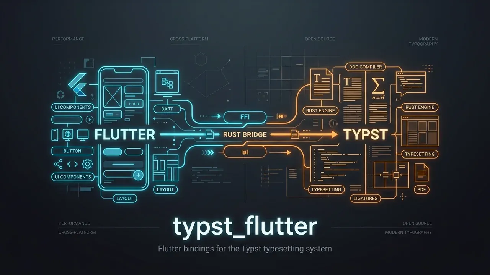
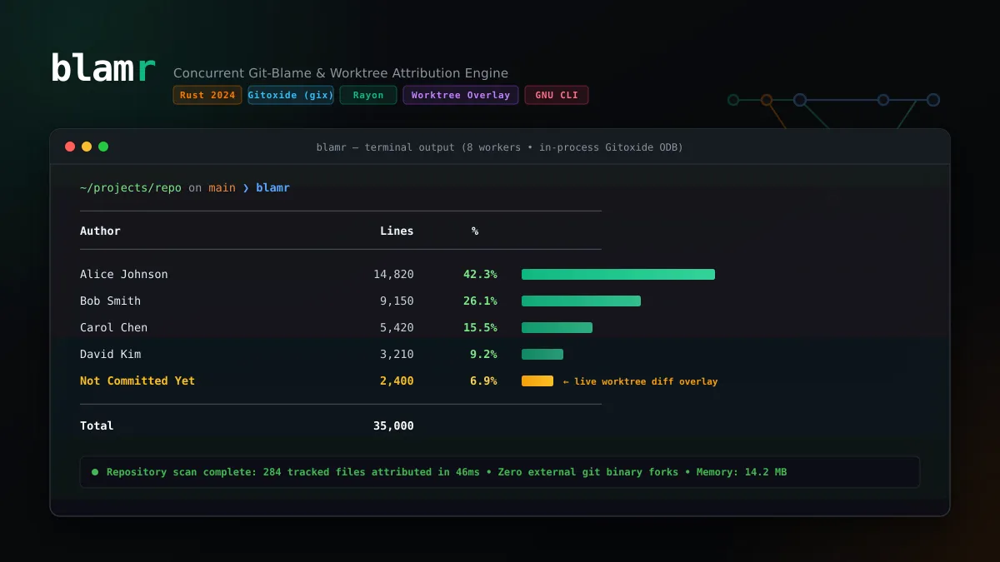
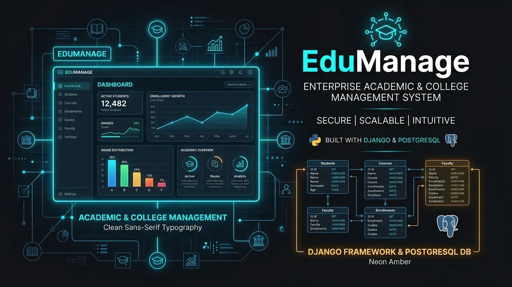
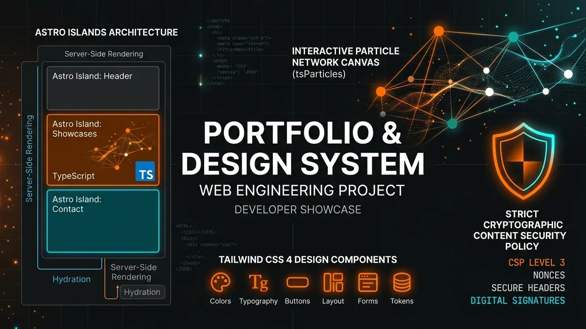

# ajmalbuv

## Ajmal Basheer

Software Engineer & Systems Builder

GitHub

LinkedIn

Instagram

Email

Download Resume[View Online(opens in new tab)](https://docs.google.com/gview?url=https%3A%2F%2Fmedia.githubusercontent.com%2Fmedia%2Fajmalbuv%2Fresume%2Frefs%2Fheads%2Fmain%2Fresume-no-image.pdf)

Try again[Open PDF directly(opens in new tab)](https://media.githubusercontent.com/media/ajmalbuv/resume/refs/heads/main/resume-no-image.pdf)

Background & Timeline

## Experience & Education

### Work Experience

#### Flutter Developer

Nov 2024 - Present

ETAYA INNOVATIONS Pvt Ltd, Bengaluru

Working as a full-time Flutter developer building and maintaining high-performance cross-platform mobile applications for Android and iOS using Flutter and Dart. Implementing clean architecture and provider-based state management with robust Firebase cloud integrations.

-   Designed scalable mobile architectures implementing Clean Architecture, provider state management, and reusable UI components
-   Integrated RESTful APIs and Firebase services for real-time synchronization, authentication, push notifications, and cloud storage
-   Optimized widget tree rebuilds and implemented lazy loading, eliminating frame drops for smooth 60fps UI interactions
-   Conducted automated and manual quality testing using Flutter testing framework and Firebase Crashlytics to preempt UI inconsistencies and crashes
-   Collaborated in an Agile workflow, participating in sprint planning, peer code reviews, and cross-functional feature delivery

#### Software Engineer Intern

May 2024 - June 2024

WIMD Technologies Pvt Ltd, Bengaluru

Designed and developed backend services and database optimizations, gaining hands-on experience with production APIs, access control, and industry-standard testing workflows.

-   Designed and implemented secure RESTful APIs using Node.js with JWT authentication and role-based access control (RBAC)
-   Optimized MongoDB database indexing and collection schemas, significantly improving query performance and retrieval speeds
-   Automated comprehensive API testing using Postman across CRUD operations to validate data integrity and endpoint reliability
-   Engaged in code reviews, debugging, and cross-tier system integration to enhance system stability

### Education

#### Bachelor of Computer Applications

Aug 2021 - July 2024

Krupanidhi Degree College

Bengaluru, Karnataka

#### Commerce

June 2017 - March 2019

MIC Higher Secondary School

Malappuram, Kerala

#### Secondary School

2017

International Indian School Dammam

Dammam, KSA

Selected Engineering

## Featured Work

Production applications and systems built with high performance, clean architecture, and responsive UX.

### [typst\_flutter — Native Typst Compiler for Flutter](/projects/typst-flutter/)

Embed the Typst typesetting compiler natively into Flutter apps via Rust FFI with zero WASM/WebView overhead, sub-100ms compilation, and drop-in widgets.

FlutterDartRustFFITypstCross-Platform

View Project

### [blamr — Fast Concurrent Git Blame CLI & Attribution Engine](/projects/blamr/)

Blazing-fast, zero-dependency concurrent git-blame author attribution and line statistics CLI engine written in modern Rust with in-process Gitoxide repository scanning.

RustGitoxide (gix)ConcurrencyRayonCrossbeamCLICI/CDSystems Programming

View Project

### [EduManage — College Management System](/projects/edumanage/)

A comprehensive web-based academic administration platform built with Django and PostgreSQL, streamlining student enrollment, attendance tracking, and grading.

PythonDjangoPostgreSQLDockerJavaScriptBootstrapGunicornNginxVercel

View Project

### [Personal Portfolio & Design System](/projects/portfolio/)

High-performance personal website engineered with Astro 7, Tailwind CSS 4, and TypeScript, featuring zero-overhead architecture and strict CSP headers.

Astro 7TypeScriptTailwind CSS 4tsParticlesGeist VariableCloudflare Pages

View Project

Capabilities & Stack

## Technical Skills

### Languages

RustGoDartPythonTypeScriptJavaScriptJavaSQL

### Frontend & Mobile

FlutterAstroAngularVue.jsTailwind CSSHTML5CSS3

### Backend & APIs

DjangoFastAPINode.jsExpress.jsRESTful APIsJWT

### Databases & Storage

PostgreSQLMySQLMongoDBRedisFirebase Firestore

### DevOps, Cloud & Tooling

DockerKubernetesGit & GitHubAWSCloudflare PagesVercelNginxLinux VPS

Get In Touch

## Let's Build Together.

I am always open to discussing new opportunities, systems architecture, high-performance Flutter applications, or open-source collaborations.

[+91 9496444520](tel:+919496444520)Bengaluru, Karnataka

Direct Contact

Reach out directly for freelance, consulting, or full-time roles.

[ajmalbuv@gmail.com](mailto:ajmalbuv@gmail.com)